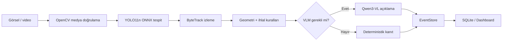

# Trafik İhlali Tespit ve Açıklama Sistemi

[](https://github.com/cansukalkan/traffic-violation-intelligence/actions/workflows/ci.yml)


Kamera görüntülerinden trafik ihlali adayı çıkaran, yalnızca gerekli olayları görsel dil
modeline yönlendiren ve denetlenebilir kanıtlarla saklayan portföy odaklı bir Python projesi.

> Bu sistem ihlal **adayı** üretir; otomatik hukuki karar veya ceza sistemi değildir.

## Canlı ürün demosu

```powershell
git clone https://github.com/cansukalkan/traffic-violation-intelligence.git
cd traffic-violation-intelligence
docker compose up -d dashboard
```

İlk çalıştırmada Compose, COCO128 smoke-test verisini resmî kaynaktan indirir ve sabit
SHA-256 değeriyle doğrular. Ardından `http://localhost:8000` adresinde dashboard açılır.
Hazır örnek seçilebilir veya kullanıcının kendi görsel/video dosyası yüklenebilir.

## Mimari



Model, takip, kural, VLM ve depolama katmanları `Protocol` arkasındadır. Böylece YOLO,
SQLite veya açıklama modeli uygulamanın geri kalanını değiştirmeden değiştirilebilir.

## Güncel durum — v1.0 / Final Sprint

- Tip güvenli YAML konfigürasyonu
- COCO128 bütünlük/sınıf dağılımı denetimi ve BDD100K için tekrarlanabilir alt küme üretimi
- İhlal etiketi şema doğrulaması
- Sınır noktalarını ve kesişmeleri kapsayan geometri çekirdeği
- Yapılandırılabilir HSV tabanlı RED/YELLOW/GREEN/UNKNOWN sinyal izleyici
- PNG geometri ve MP4 trafik ışığı demoları
- Modelden bağımsız `Detector` Protocol ve deterministik `FakeDetector`
- Lazy-load Ultralytics YOLO sarmalayıcısı, gerçek çıkarım, ince ayar ve ölçüm arayüzleri
- ByteTrack kimlikleri için sınırlı iz geçmişi ve kayıp iz temizliği
- Kırmızı ışık toleransı, dur çizgisi ve yaya geçidi için açıklanabilir aday kuralları
- Modelden bağımsız `Describer` Protocol, deterministik sahte VLM ve katı JSON ayrıştırma
- Lazy-load Qwen3-VL-4B adaptörü, 4-bit donanım ön kontrolü ve prompt-injection sınırı
- Model lisans kapısı: araştırma lisanslı Qwen2.5-VL-3B devre dışı, Apache-2.0 Qwen3-VL etkin
- Cooldown, dakikalık bütçe ve güven eşiği uygulayan VLM yönlendirme politikası
- Değiştirilebilir `EventStore` Protocol ve WAL modlu, iş parçacığı güvenli SQLite uygulaması
- Zaman damgalı video kare kaynağı ve senkron referans pipeline
- 12 mantıksal rolü 31 asenkron işçiye eşleyen, sınırlı kuyruklu orkestrasyon katmanı
- Rol bazında işlenen/hatalı/düşürülen mesaj, kuyruk derinliği ve p50/p95 gecikme ölçümleri
- CUDA/VRAM/TensorRT durumuna göre PyTorch, ONNX Runtime ve TensorRT yollarını seçen
  donanım katmanı
- Isınma, FPS, p50/p95 gecikme ve Python tepe bellek ölçümü yapan benchmark arayüzü
- Tür ve zaman toleransına göre bire bir olay eşleştirme; precision, recall ve F1 metrikleri
- Dışarıdan JPG/PNG/video yükleyen veya hazır COCO128 galerisinden seçim yaptıran FastAPI dashboard
- OpenCV medya doğrulaması, video hareket ölçümü, açıklamalı önizleme ve SQLite analiz geçmişi
- Kaynak doğrulama ile YOLO çıkarımını ayıran, çalışma modunu arayüzde açıkça gösteren servis
- 99 çevrimdışı birim testi; gerçek YOLO, OpenCV ONNX ve kısa CPU eğitim duman testi
- Yerel ve Docker tabanlı demo akışı
- SQLite-first veri mimarisi kararı; PostgreSQL henüz etkin değil

## Hızlı başlangıç

```powershell
python -m venv .venv
.venv\Scripts\Activate.ps1
python -m pip install -e ".[dev,web]"
pytest -v
python demo/00_data.py
python demo/01_config.py
python demo/02_geometry.py
python demo/03_signal.py
python demo/04_detect.py
python demo/05_tracking.py
python demo/06_rules.py
python demo/07_vlm_parse.py
python demo/08_qwen.py
python demo/09_routing.py
python demo/10_store.py
python demo/11_pipeline.py
python demo/12_agents.py
python demo/13_bench.py
python demo/14_eval.py
python demo/15_full_demo.py
```

Demo çıktıları `reports/demos/` altında oluşur. BDD100K henüz indirilmediyse veri demosu
başarısız olmaz; eksik veri ve resmi indirme adresini açıkça raporlar.

ML bağımlılıkları kurulduğunda gerçek YOLO yolu ve tekrarlanabilir COCO128 smoke eğitimi:

```powershell
python -m pip install -e ".[dev,ml]"
python demo/04_detect.py --image data/coco128/images/train2017/000000000257.jpg
python demo/04_finetune.py --device cpu --imgsz 320 --epochs 1
```

COCO128'de eğitim ve doğrulama aynı görüntüleri kullanır. Bu nedenle raporlanan metrikler
yalnızca teknik boru hattı doğrulamasıdır; ürün veya genelleme başarımı değildir.

Gerçek CPU hız yollarını aynı COCO128 karelerinde karşılaştırmak için:

```powershell
python -m pip install -e ".[dev,ml,optimize]"
python demo/13_bench.py --real --limit 32 --repeats 3 --imgsz 320
```

Bu makinedeki ölçümde PyTorch FP32, ONNX Runtime CPU'dan daha hızlı çıktı. Sonuçlar
donanıma özeldir; başka bir makine için yeniden ölçülmelidir.

## Ölçülen sonuçlar

| Ölçüm | Sonuç | Kapsam |
| --- | ---: | --- |
| PyTorch FP32 CPU | 7,29 FPS | YOLO11n, 320 px, 32 kare × 3 tekrar |
| PyTorch gecikme | p50 127,48 ms / p95 170,37 ms | Aynı donanım |
| ONNX Runtime CPU | 4,72 FPS | Aynı görüntüler |
| Sentetik olay precision | %50,0 | 2 TP / 2 FP |
| Sentetik olay recall | %66,7 | 2 TP / 1 FN |
| Sentetik olay F1 | %57,1 | Kabul senaryosu, ürün accuracy'si değil |

Gerçek ürün doğruluğu, bağımsız ve insan etiketli ihlal klipleri olmadan iddia edilmez.
COCO128 yalnızca boru hattının teknik olarak çalıştığını doğrulamak içindir.

## Docker

Dockerfile iki hedef sunar: hızlı test/CI için küçük bir CPU imajı ve gerçek model çalışmaları
için PyTorch–CUDA tabanlı GPU imajı:

```powershell
docker compose build app
docker compose run --rm app
```

Gerçek ürün dashboard'unu başlatmak için:

```powershell
docker compose up -d dashboard
```

Ardından tarayıcıda `http://localhost:8000` adresini açın. JPG, PNG, MP4, AVI, MOV veya
MKV dosyası yüklenebilir. Varsayılan Docker servisi `onnx` modundadır: YOLO11n modelini
OpenCV DNN ile çalıştırır; araç, insan ve trafik nesnelerini kutu ve güven skoruyla gösterir.
Sonucu SQLite'a kaydeder. Kullanıcının dosyası yoksa aynı ekrandaki salt okunur COCO128 örnek
galerisinden seçim yapılabilir. Sağlık kontrolü `http://localhost:8000/health`, API belgesi ise
`http://localhost:8000/docs` adresindedir.

PyTorch YOLO yolu için ML bağımlılıklarını içeren ortamda `TV_ANALYZER_MODE=yolo` ve
`TV_MODEL_PATH` ayarlanır. İhlal kararı ayrıca her kamera için dur çizgisi, sinyal bölgesi ve
yaya geçidi geometrisi gerektirir; tek karede nesne görmek hukuki ihlal kararı değildir.

GPU doğrulaması için Docker Desktop çalışır durumda olmalı; Windows/WSL2 ana makinesinde
güncel NVIDIA sürücüsü ve NVIDIA Container Toolkit bulunmalıdır:

```powershell
docker compose --profile gpu run --rm gpu-check
docker compose --profile gpu run --rm gpu-app
```

`nvidia-smi` çıktısı alınamıyorsa GPU yolu etkinleştirilmez. Yerel donanım seçimi
`configs/hardware.yaml` dosyasından yapılır.

Qwen modeli çok gigabaytlıktır ve varsayılan demoda indirilmez. GPU ön kontrolü geçtikten sonra
model yükleme açıkça etkinleştirilir:

```powershell
docker compose --profile gpu run --rm gpu-app `
  python demo/08_qwen.py --run-model --image data/example.jpg
```

## Mimari kararlar

- Python 3.11+ ve tüm genel arayüzlerde tip ipuçları kullanılır.
- Model çağrıları `Protocol` arkasında tutulur; birim testleri gerçek model yüklemez.
- İlk kalıcı depo SQLite'tır. `EventStore` arayüzü tanımlıdır; PostgreSQL uygulaması çoklu
  kamera veya eşzamanlı yazma yükü oluştuğunda aynı sözleşmeyle eklenecektir.
- Ham kareler için hedef saklama süresi yedi gündür; plaka ilk sürüm kapsamı dışındadır.
- Ultralytics entegrasyonu nedeniyle dağıtım lisansı AGPL-3.0-or-later olarak seçilmiştir.

## Proje yapısı

```text
src/traffic_violation/
├── detection/     # YOLO ve modelden bağımsız tespit sözleşmesi
├── tracking/      # İz geçmişi ve ByteTrack adaptasyonu
├── rules/         # Kırmızı ışık, dur çizgisi ve yaya geçidi kuralları
├── vlm/           # Qwen3-VL adaptörü ve güvenli JSON ayrıştırma
├── storage/       # EventStore ve SQLite
├── pipeline/      # Senkron referans boru hattı
├── optimize/      # Donanım seçimi, export ve benchmark
├── eval/          # Precision, recall, F1 ve eşleştirme
└── web/           # FastAPI dashboard ve güvenli medya yükleme
```

## Sınırlamalar ve sonraki adımlar

- Dashboard nesne tespitini gerçek modelle yapar; tam ihlal kararı kamera geometrisi ve
  zamansal izleme yapılandırıldığında üretilir.
- Plaka tanıma ilk sürüm kapsamı dışındadır.
- PostgreSQL, çoklu kamera veya yüksek eşzamanlı yazma ihtiyacında `EventStore` sözleşmesi
  üzerinden eklenecektir.
- Qwen3-VL modeli büyüklüğü nedeniyle varsayılan Docker demosunda indirilmez.

## Lisans

Kod [AGPL-3.0-or-later](LICENSE) ile lisanslanmıştır. Veri ve model kaynaklarının ayrı
koşulları [data/LICENSES.md](data/LICENSES.md) içinde kayıtlıdır.

Veri ve model lisans kayıtları için [data/LICENSES.md](data/LICENSES.md), çalışma yöntemi
ve Definition of Done için [docs/SCRUM.md](docs/SCRUM.md) dosyasına bakın.

